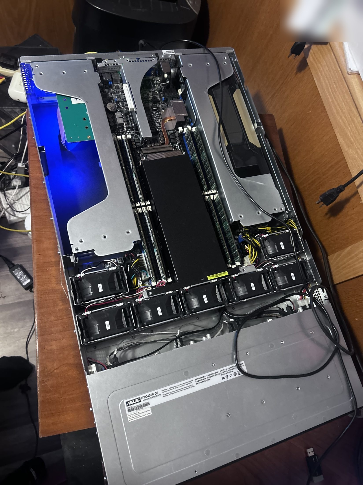
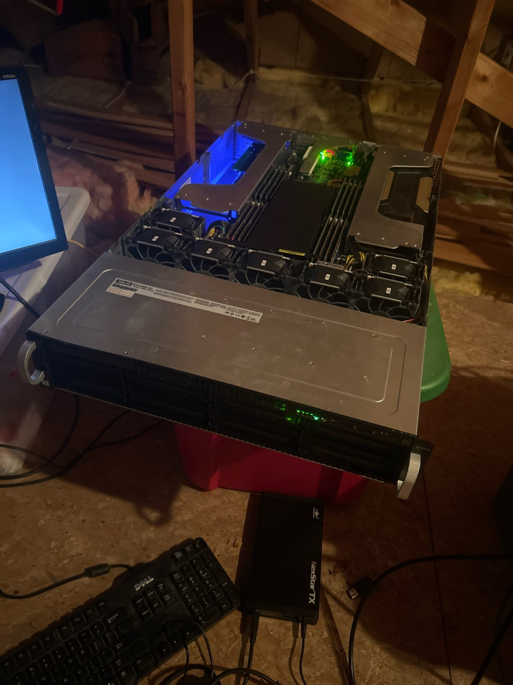
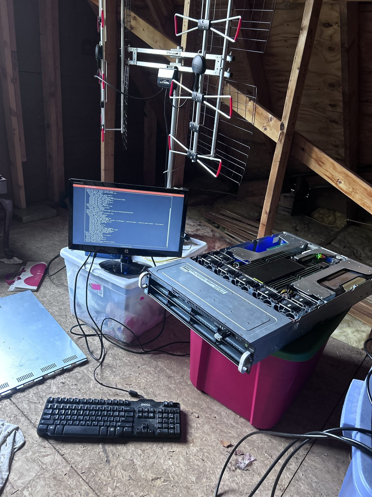
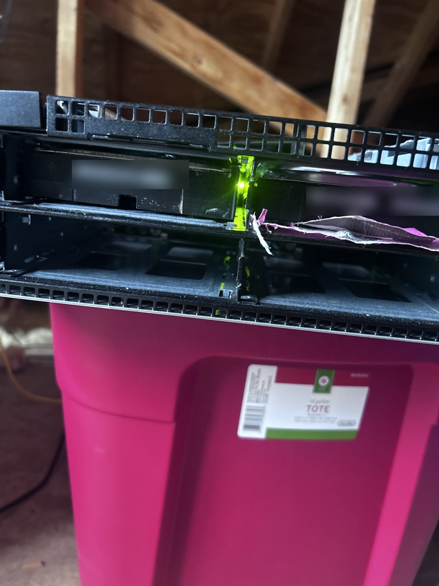
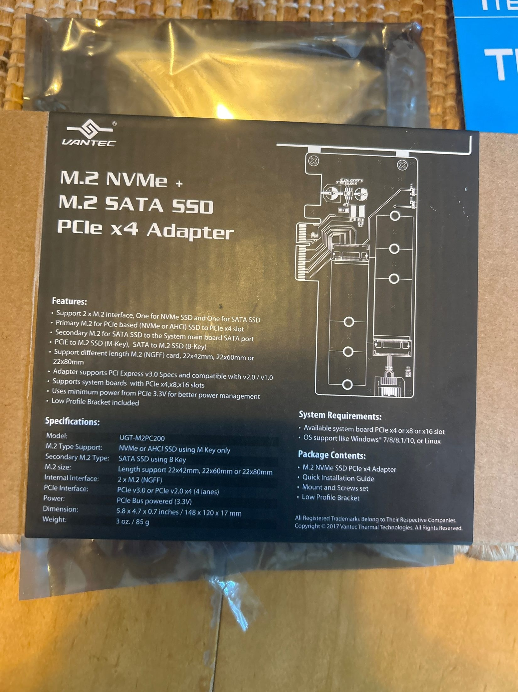
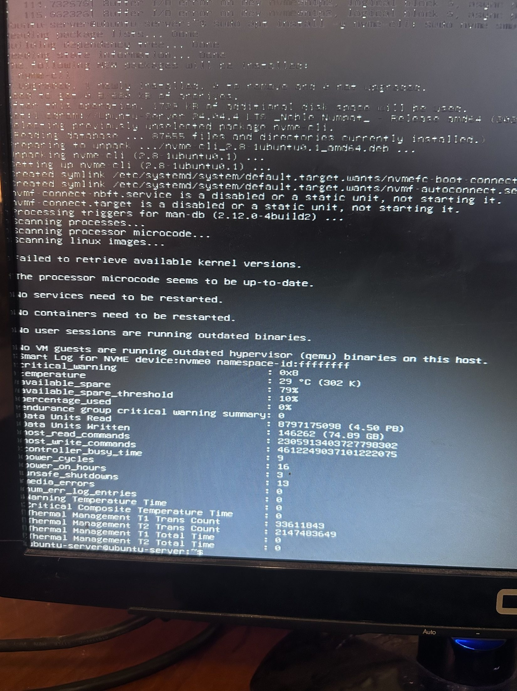
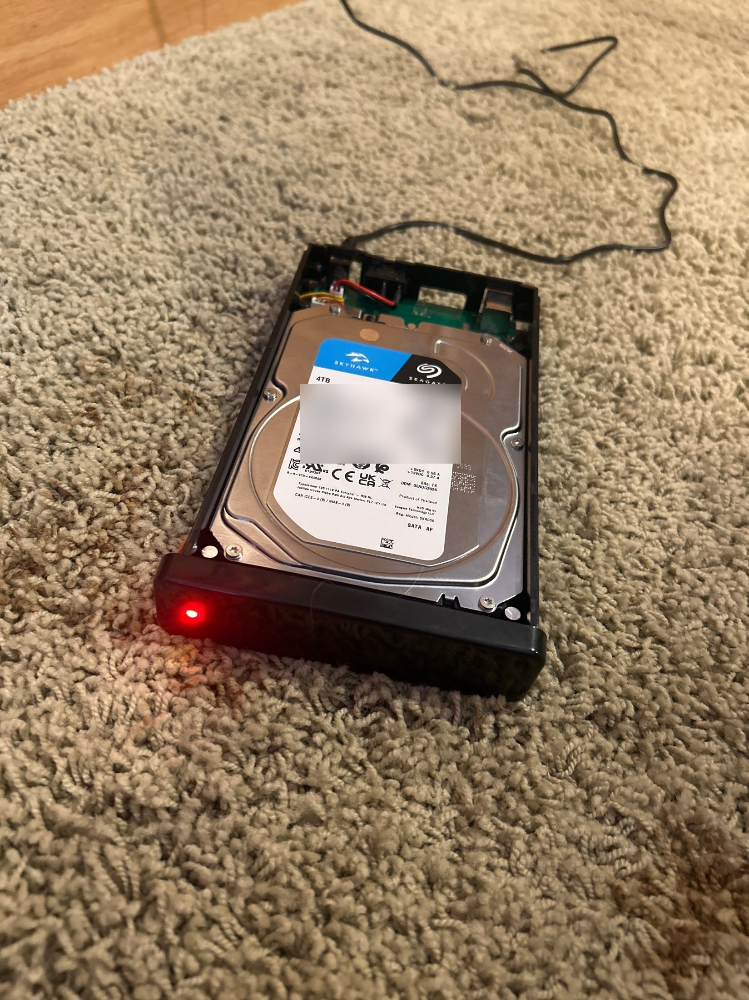
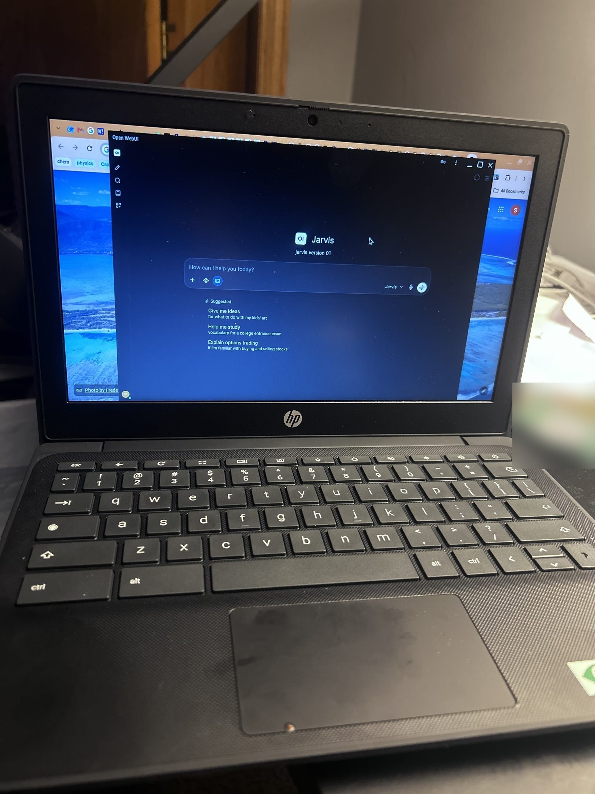

# Home AI Lab


I built a dual-GPU server at home from used parts to learn how language models
actually work, by training them myself instead of only using them. I use it to
train transformers from scratch, run and fine-tune open-weight models, and do
the data work behind [careerfieldnotes.com](https://careerfieldnotes.com).

<p align="center">
  
</p>

## Contents

- [The server](#the-server)
- [Training models from scratch](#training-models-from-scratch)
- [Running and fine-tuning open models](#running-and-fine-tuning-open-models)
- [careerfieldnotes.com](#careerfieldnotescom)
- [Quickstart](#quickstart)
- [Repository layout](#repository-layout)
- [Roadmap](#roadmap)

## The server

| | |
|---|---|
| Chassis | ASUS ESC4000 G3 (2U GPU server) |
| GPUs | 2× NVIDIA Tesla V100 16 GB (PCIe, no NVLink) |
| CPUs | 2× Intel Xeon E5-2699 v3 (36 cores, 72 threads) |
| RAM | 503 GiB |
| OS | Ubuntu Server 24.04 LTS, CUDA 12.9 |
| Storage | M.2 NVMe on a PCIe adapter (replaced September 2026), plus a 4 TB external drive |
| Cost | about $2,000 total, from 12 eBay and Facebook Marketplace listings |
| Built | October 2025 |
<table>
  <tr>
    <td></td>
    <td></td>
    <td></td>
  </tr>
  <tr>
    <td align="center">Running in the attic</td>
    <td align="center">Installing Ubuntu Server</td>
    <td align="center">Front drive bays</td>
  </tr>
  <tr>
    <td></td>
    <td></td>
    <td></td>
  </tr>
  <tr>
    <td align="center">M.2 NVMe to PCIe x4 adapter</td>
    <td align="center">Checking the NVMe drive's SMART log<br>while chasing I/O errors</td>
    <td align="center">4 TB drive for extra storage</td>
  </tr>
</table>

Video walkthrough: [docs/video/tour.mp4](docs/video/tour.mp4)

## Training models from scratch

I trained five decoder-only transformers, from 44M to 457M parameters. The
code here ([`model/transformer.py`](model/transformer.py),
[`model/tokenizer.py`](model/tokenizer.py)) was reconstructed and cleaned up in
November 2026, after those runs. Each run has its own config in [`training/configs/`](training/configs/), so
diffing two configs shows exactly what changed between runs.

| Run | Params\* | Layers | Width | Heads (KV) | Context | What changed |
|---|---|---|---|---|---|---|
| M1 | 44M | 6 | 512 | 8 | 512 | baseline, constant LR |
| M2 | 71M | 8 | 640 | 10 | 1024 | warmup + cosine schedule, longer context |
| M3 | 123M | 12 | 768 | 12 | 1024 | deeper and wider, lower LR |
| M4 | 236M | 16 | 1024 | 16 (8) | 2048 | grouped-query attention, 2048 context |
| M5 | 457M | 20 | 1280 | 20 | 2048 | largest run |

\* Total parameters with a 50k vocabulary and tied embeddings.

**Main finding: data quality beat model size.** M3 (123M) trained on the
cleaned corpus did better than the M4 architecture (236M) trained on the raw
corpus. [`training/prepare_data.py`](training/prepare_data.py) builds both
versions of the data, and
[`model4_236M_raw.yaml`](training/configs/model4_236M_raw.yaml) is the
raw-data config.

I didn't keep the logs or checkpoints from these runs. The training script now writes a
`log.csv` for every run, so future results will have the logs to back them up.

Model features: pre-norm RMSNorm, rotary position embeddings (RoPE),
grouped-query attention, tied input/output embeddings, AdamW with warmup and
cosine decay, gradient clipping, mixed precision (fp16 on V100s, which have
no bf16 support), and two-GPU data parallel training with `torchrun`.

## Running and fine-tuning open models

The server also runs open-weight models, including Qwen and DeepSeek. The
models are served by [llama.cpp](https://github.com/ggml-org/llama.cpp), with
[Open WebUI](https://github.com/open-webui/open-webui) as the chat interface.
I named the setup
"Jarvis" and use it from my laptop like any chat app, except everything runs
on my own hardware.

<p align="center">
  
</p>

I've also fine-tuned some of these models and experimented with them.

## careerfieldnotes.com

[careerfieldnotes.com](https://careerfieldnotes.com) is my site. The server
analyzes the site's data and helps sort the data and the quotes collected
from people. More in [`careerfieldnotes/`](careerfieldnotes/).

## Quickstart

```bash
pip install -r requirements.txt

# 1. put plain-text documents (one per .txt file) in corpus/, then build the
#    tokenizer and the token files
python training/prepare_data.py --src corpus/ --out data/clean --train-tokenizer

# 2. train a small model to check everything works (minutes on one GPU)
python training/train.py --config training/configs/tiny_quickstart.yaml

# 3. generate some text
python training/sample.py --ckpt runs/tiny_quickstart/ckpt.pt --prompt "The"

# bigger runs on both GPUs
torchrun --nproc_per_node=2 training/train.py --config training/configs/model3_123M.yaml
```

Add `--resume` to continue a run from its last checkpoint.

## Repository layout

```
model/
  transformer.py      decoder-only transformer (RMSNorm, RoPE, GQA)
  tokenizer.py        byte-level BPE tokenizer: train, encode, decode
training/
  prepare_data.py     clean, dedup, tokenize a text corpus into token files
  train.py            training loop: mixed precision, multi-GPU, CSV logs, checkpoints
  sample.py           generate text from a checkpoint
  configs/            one YAML config per run
analysis/plot_logs.py plot validation loss from real run logs
scripts/              rerun the clean-vs-raw experiment, record system info
tests/                tokenizer, model, full pipeline, and repo checks (pytest)
careerfieldnotes/     how the server is used for careerfieldnotes.com
docs/                 photos and video of the build
```

## Roadmap

- [ ] Re-run the clean-vs-raw comparison (M3 vs M4-raw) with full logging and
      publish the loss curves
- [ ] Benchmark the from-scratch models against small open models
- [ ] Write up the fine-tuning experiments

## License

[MIT](LICENSE)
